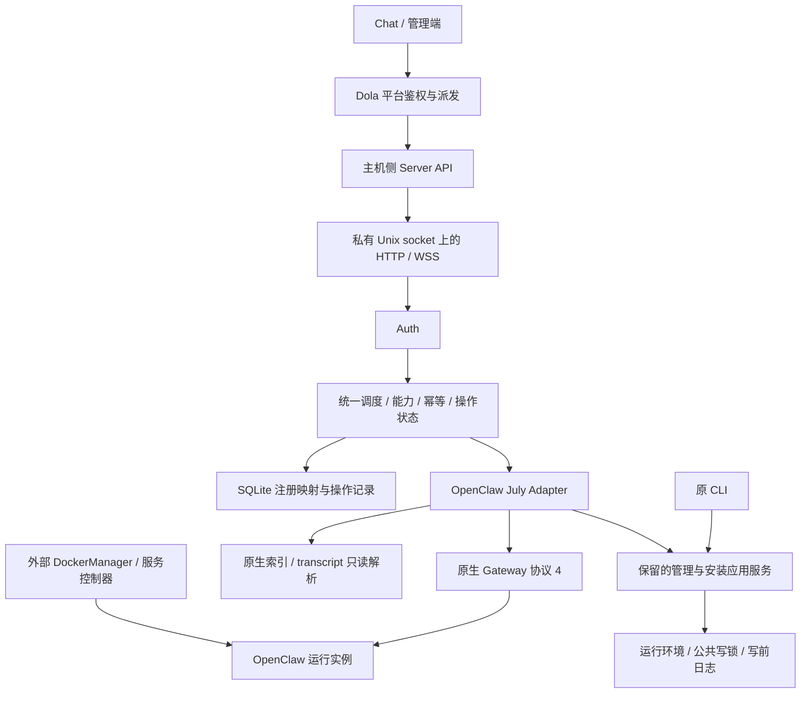

# Agent Manager 1.0 架构

当前处于 API 1.0 接入验证阶段。旧 CLI 入口与参数继续保留，发布记录和升级限制见 [CHANGELOG.md](../CHANGELOG.md)。
这是已讨论方案的仓库实现说明；完整产品设想中的远程 Manager、DSH、评测、分享和 Site 不计入本次实现能力。

## 依赖与边界



| 模块 | 负责 | 不负责 |
| --- | --- | --- |
| `core/runtime.py` | 显式配置、状态目录、HOME、子进程环境 | 不切换进程全局环境变量 |
| `core/transactions.py` / `recovery.py` | 本机进程与线程间写互斥、已知刷新文件恢复 | 不回滚网络请求、npm 安装或任意脚本 |
| `core/store.py` | 稳定 ID、幂等记录、操作状态、租约 | 不复制全文 transcript，不成为原生聊天数据库 |
| `core/auth.py` | 执行租约中的 Runtime、Agent、action 范围 | 不维护用户、团队、订单或套餐 |
| `core/service.py` | 调度、授权、限流、持久化操作 | 不向客户端提供任意 native RPC 或 shell 转发 |
| `adapters/registry.py` | 按 Runtime 注册信息中的 `engine` 选择底座工厂 | 不承载原生协议 |
| `adapters/openclaw/` | 探测实际版本，选择协议实现，桥接原生能力 | 不将不同 OpenClaw 版本直接视为相同实现 |
| 主机侧 Server API | 接收平台鉴权后的派发和流量，向本机 Manager 委托范围 | 不向浏览器暴露 Manager 的内部凭据或 socket |
| `server.py` | Unix socket 上的 HTTP/WSS、接收委托、请求/输出预算、流量背压 | 不决定谁购买了哪个 Agent |
| 原 mixin 模块与 CLI | 原有安装、刷新、模型、渠道、Codex、Fly、历史命令 | 不要求所有旧用户立即运行新服务 |

保留旧应用服务并由 adapter 调用，使现有测试继续约束业务语义；没有复制一套创建、刷新和登录实现。
当前控制命令的详细 `result` 仍是脱敏后的旧业务结果，外层 Operation、鉴权、标识与 Chat DTO 已统一。
后续可逐域替换内部实现，不要求前端重新实现原生协议。

## 新底座与版本适配

```text
agent_manage/
├── core/contracts.py                    # HTTP/WSS 共用的公开方法
└── adapters/
    ├── base.py                          # RuntimeAdapter
    ├── registry.py                      # engine → 工厂
    ├── openclaw/
    │   ├── factory.py                   # 校验注册信息、探测版本、选择实现
    │   └── v2026_7/
    │       ├── adapter.py               # 统一方法、对象归属、能力声明
    │       ├── gateway.py               # OpenClaw 原生 Gateway 连接
    │       └── projection.py            # 原生消息到 v1 数据结构
    └── dsh/                             # 未来接入时的目录示例
        ├── factory.py
        └── <version_family>/
            ├── adapter.py
            ├── client.py
            └── projection.py
```

1. **按底座和版本范围建目录。** 每个底座在 `adapters/<engine>/factory.py` 提供自己的工厂，并在 `registry.py` 注册。包括 DSH 在内，首个实现也放在 `adapters/<engine>/<version_family>/`。该目录内的 `adapter.py` 实现统一接口，`client.py` 或 `gateway.py` 调用原生协议，`projection.py` 转换消息和事件。
2. **按协议兼容范围选实现。** 工厂从实际可执行文件或安装元数据探测版本，并校验该底座的注册配置。原生协议、配置和存储格式兼容的版本可共用一个子目录，已验证的具体版本单独记录。DSH 的预发行版本也要单独判断兼容性。同一个底座可在多个 Runtime 上选择不同实现，各自绑定配置、状态目录、HOME 和原生连接。
3. **复用统一方法合同。** 在 `adapter.py` 实现 `base.py` 的 `RuntimeAdapter`。用 `resolve_scope` 按 Runtime 内的对象归属定位 Agent，用 `invoke` 接收统一请求和返回统一数据。媒体通过 `resource_chunk` 提供分块读取，实时事件通过传入的 `publish` 回调送到统一 WSS。关停连接由 `close` 处理。增加公开方法时，在 `core/contracts.py` 一次定义参数、读写类型和授权范围。
4. **按实际能力声明和验证。** `capabilities.get` 分别报告支持、就绪、授权和已验证版本。已注册底座的版本匹配失败时，仍可查询 Runtime 信息和能力，底座操作返回 `UNSUPPORTED_VERSION`。未实现的方法声明为 `unsupported`，调用时返回 `UNSUPPORTED`。新增实现应验证版本路由、对象归属隔离，以及所声明能力的原生调用和统一输出。

## 对象与数据流

管理员配置 `Target → Environment → Runtime`。Runtime ID 表示一个运行实例，engine/version 是它的属性。
Agent/Thread/Segment/Resource 使用持久映射；同名 Agent 在不同 Runtime 下不会撞 ID。
历史 message ID 与所在 Thread/Segment 一起使用，不能脱离范围单独检索。

读取：请求 → 租约/action/对象归属 → Adapter → 本地索引或 Gateway → DTO → 再检查授权 → 返回。
写入：授权 → 持久化幂等记录 → accepted Operation → 执行 → completed/failed/unknown → 客户端查询 Operation。
`requestId` 只关联一次响应；`clientRequestId` 标识一次业务写操作。
断线、进程退出、上游超时均不代表原操作没有执行，unknown 不自动重发。
Operation 保存调用者及 Agent/Thread 范围，发送尚未建立 Run 时也能查询接受记录；不会为状态轮询要求 Runtime 管理权限。

Run 的 completed 表示原生运行结束；Operation 的 completed 只表示该命令提交成功。
`runs.create` 的 Operation 完成时，Run 仍可能 running。取消提交成功先是 cancel_requested，等待原生确认。
读取旧段不会修改 native sessionId、updatedAt、标题或侧栏排序；发送始终面向逻辑线程的当前段。
发送携带 expectedCurrentSegmentId；Manager 原生写命令串行检查。OpenClaw 7 没有原子段 CAS，其他入口直接重置的竞争仍需迁移时统一写入口解决。

## 多环境与生命周期

- 多个本地 Runtime 可以由同一个服务管理，配置/状态目录不可重叠，不同 Environment 的 HOME 必须明确分离。
- v1 子进程只继承基础 OS 环境，凭据、代理等通过管理员注册的 `environment` 显式提供；禁止用它覆盖路由字段。
- `executable` 必须对应该 Runtime 的安装包；从实际包读取版本，不接受前端声明版本。
- `lifecycle: external` 时不调用全局 systemctl/pgrep；返回交由外部控制器重启。`openclaw` 模式先验证原生服务的配置归属再重启。
- Docker 创建、删除、端口与卷的分配仍由已有 DockerManager 负责。实例内运行 Manager 服务时，只管理已挂载的那个环境。
- 本次没有实现“宿主机自动进入任意 Docker 容器执行”，也没有用 Docker socket 换取隐式宿主权限。
- 同一 Environment 内的 Agent 仍共享底座进程和信任域；网络授权不是恶意工具代码的 OS 沙箱。
- 本地多 Runtime 面向同一受信管理员。安装脚本能以服务用户身份执行代码，不能把它当作不可信租户的隔离边界；跨租户执行仍需独立容器/OS 身份及外部控制器。

## 一致性与恢复

公共写锁先于 refresh/Codex/Fly/安装的细分锁，完整覆盖 read-modify-write。配置有读取版本校验；回滚发现独立修改时停止覆盖。
刷新先落盘备份及计划中的 before/after 指纹，随后原子替换文件和状态。后续管理写入、容器启动与显式 `runtimes.recover` 会恢复未完成的已知写入。
存在用户独立修改或旧格式未完成日志时返回 RECOVERY_REQUIRED，避免带着混合版本继续安装。
CLI 外部直接编辑和 OpenClaw 自身写文件不会遵守此锁；指纹检测用于发现可观察冲突，不宣称跨进程任意写入的数据库式串行化。

SQLite 使用 WAL + FULL 同步，状态目录 0700、数据库/密钥 0600；一个 stateDirectory 由一个服务进程持有。
原生消息仍在 OpenClaw；停用服务不会丢失聊天。恢复时必须一起保存 Manager 状态与底座状态，否则不能承诺旧统一 ID/操作查询连续。

## 性能和未实现边界

历史、控制、媒体有独立工作池；没有无限排队。WSS 不在事件循环中执行旧同步命令。
媒体只缓存至多 256 个文件指纹，不缓存文件内容；冷读取校验完整 hash，后续按文件身份校验并读取指定字节。
历史保留快照复核，当前仍扫描所选 transcript；没有用弱校验换取可能串段的缓存。
实时流不持久化全文；活动文本缓存最多 32 份，每份 256 KiB。慢消费者清队列并要求 resync。

当前不承诺事件重放、历史与实时之间的原子 watermark、恰好一次原生模型运行或跨系统事务。
消息 ID 无法与历史关联时显式 `correlation: unresolved`，前端以历史快照校正，不能按正文盲目去重。
DSH、新版 OpenClaw、远程连接、分享、Site、记忆编排和评测均留在独立扩展边界，能力表返回 unsupported。

生产迁移顺序仍是：只读历史/媒体 → 离线最小闭环验证 → 灰度实时流 → 管理写操作。旧 Chat WSS 本次没有改动。
